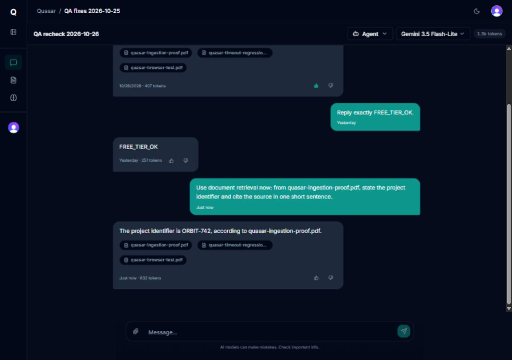
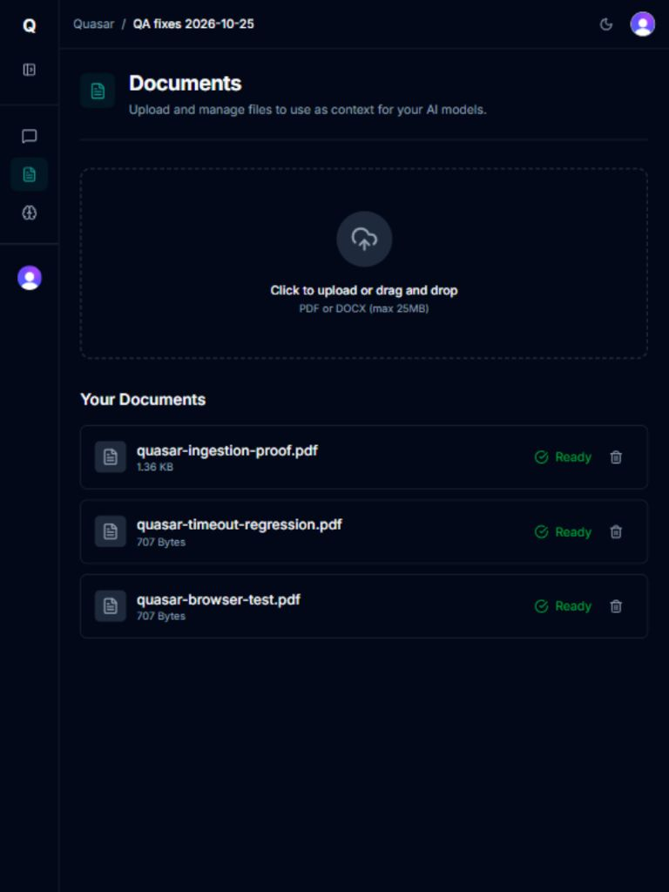

<div align="center">

# ✦ Quasar

### Your models. Your documents. One workspace.

An AI developer workspace for streaming conversations, answers with sources, and agents that pause for your approval.

**[Open the live app](https://qausar.vercel.app)** · **[Explore the architecture](docs/Architecture.md)** · **[Run locally](#run-locally)**

[](https://nextjs.org/)
[](https://www.typescriptlang.org/)
[](https://fastapi.tiangolo.com/)
[](https://github.com/pgvector/pgvector)

</div>

<p align="center">
  
  <br>
  <sub>Desktop · 1280 × 900 · Answers connected to your documents.</sub>
</p>

## What you can do

| | Inside Quasar |
| :--- | :--- |
| 💬 **Chat across providers** | Stream responses, render code, and choose a model per conversation. Gemini Flash-Lite is the default; premium models require your own provider key. |
| 📚 **Ask your documents** | Upload PDF or DOCX files, follow indexing progress, and open source citations alongside answers. |
| 🧠 **Keep useful context** | Save and manage preferences that carry into future conversations. |
| 🤖 **Work with agents** | Follow Planner → Coder → Reviewer runs, inspect tool activity, and approve changes before execution. |
| 🗂️ **Separate your work** | Keep conversations, documents, memory, and agent runs scoped to individual workspaces. |
| 🔑 **Control your keys and usage** | Add encrypted provider keys in Settings and inspect recorded token and cost usage. |

## A look across screens

Real screenshots from the deployed app, using a synthetic QA workspace. Three views, from a full chat workspace to a compact mobile form.

<table>
  <tr>
    <td align="center" width="50%"><strong>Tablet · Document library</strong></td>
    <td align="center" width="50%"><strong>Mobile · Memory</strong></td>
  </tr>
  <tr>
    <td align="center" valign="top">
      
      <br><sub>768 × 1024 · Uploads and indexing status.</sub>
    </td>
    <td align="center" valign="top">
      
      <br><sub>390px wide · Preferences within reach.</sub>
    </td>
  </tr>
</table>

## Under the hood

| Layer | Built with |
| :--- | :--- |
| **Web & API** | Next.js App Router, React, TypeScript, Vercel AI SDK, Clerk |
| **Retrieval & agents** | FastAPI, LangGraph, Gemini embeddings, hybrid retrieval with reciprocal rank fusion |
| **Data & operations** | PostgreSQL / pgvector, Prisma, Supabase Storage, LangSmith, GitHub Actions |

The Next.js API owns user authorization and provider routing; FastAPI handles document processing, retrieval, and agent execution. Provider keys are encrypted with AES-256-GCM, and PostgreSQL enforces durable request quotas. Architectural tradeoffs—including deliberately deferred features—are recorded in the [ADRs](docs/Decisions.md).

> **Live demo:** The backend uses Render's free tier and can sleep while idle. Its first request may take around a minute to start; provider quotas also apply. The demo currently uses Clerk development mode.

## Run locally

Use **Node.js 20+** and **Python 3.11+**. The [environment setup guide](docs/Environment-Setup.md) covers credentials, the backend virtual environment, database setup, and migrations.

```bash
git clone https://github.com/KhuzaimaHassan/Quasar.git
cd Quasar
npm ci
```

After completing the environment setup, start the services in separate terminals:

```bash
# Frontend — repository root
npm run dev

# Backend — with its Python virtual environment activated
cd backend
python -m uvicorn main:app --reload --port 8000
```

Frontend checks run locally without model requests:

```bash
npm run type-check
npm run lint
npm test
npm run scan:secrets
```

See [Contributing](docs/Contributing.md) for backend checks, responsive verification, and the branch → PR → CI workflow.

## Go deeper

| Explore | Documentation |
| :--- | :--- |
| **System design** | [Architecture](docs/Architecture.md) · [Decision records](docs/Decisions.md) · [Database](docs/Database.md) |
| **AI features** | [Chat pipeline](docs/AI-Pipeline.md) · [RAG](docs/RAG.md) · [Agents](docs/Agents.md) · [Memory](docs/Memory.md) |
| **Build & deploy** | [Environment setup](docs/Environment-Setup.md) · [API reference](docs/API.md) · [Deployment](docs/Deployment.md) |
| **Engineering** | [Security](docs/Security.md) · [Performance](docs/Performance.md) · [Contributing](docs/Contributing.md) |
| **Project story** | [Roadmap](docs/Roadmap.md) · [Lessons learned](docs/Lessons-Learned.md) · [RAG evaluation](docs/rag-evaluation.prd.md) · [GitHub setup](docs/GitHub-Setup.md) |
